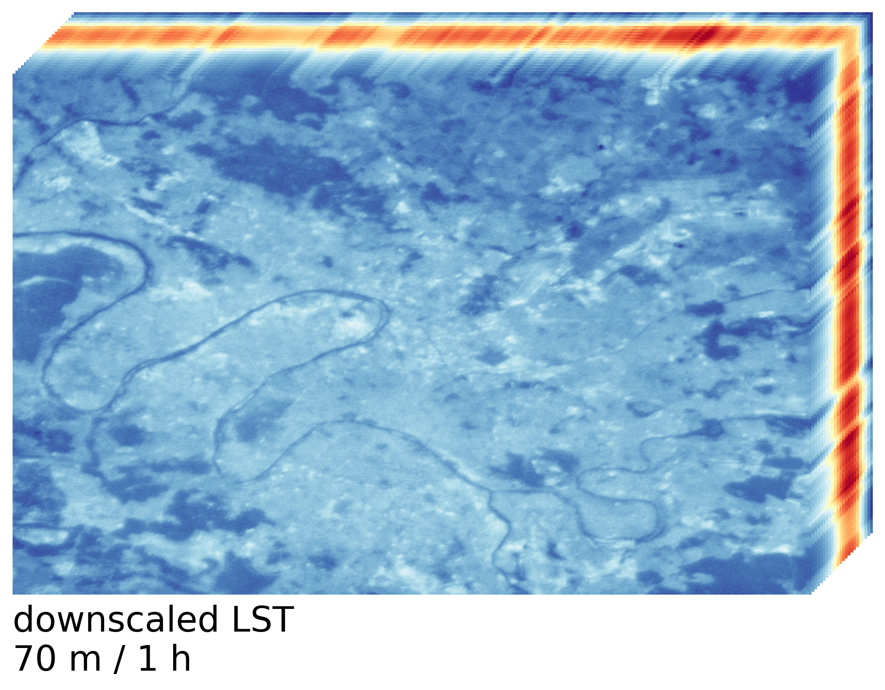
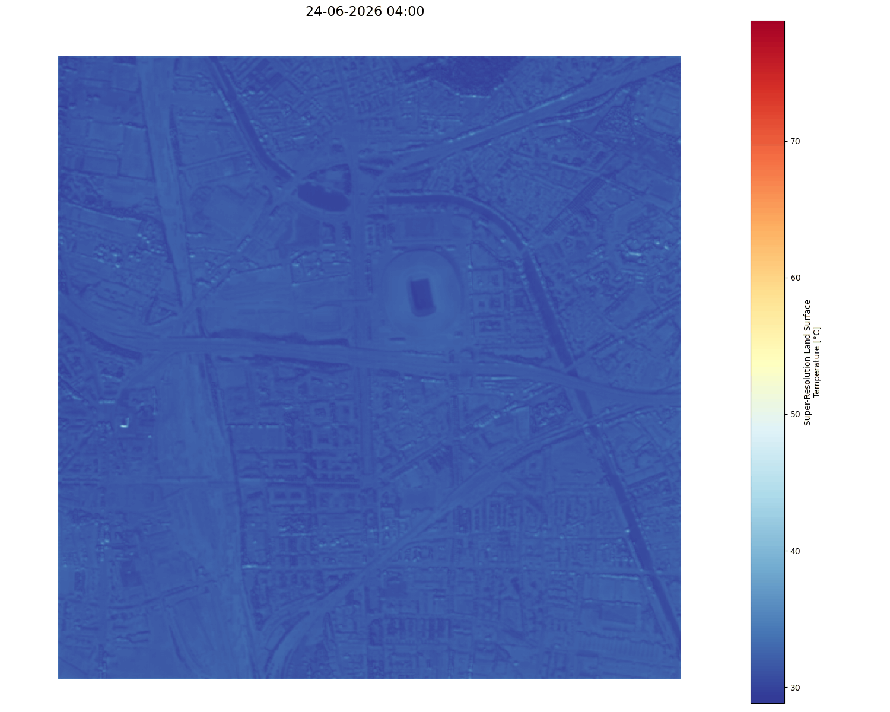

# DeThermIn: a complete workflow towards spatio-temporally refined Land Surface Temperature

The aim of this workflow is to derive Dense Thermal Information (**DeThermIn**) for urban areas. More precisely, it refines Land Surface Temperature (LST) from space-borne thermal imagery at a nearly-continuous temporal resolution and up to 0.5 meters of spatial resolution.

This repository aims to make easily reproducible the methodology and tools used in the following:
> **Chardon, T. (2026): *Use of 3D Point Clouds with Advanced Deep Learning Techniques for Satellite Thermal Imagery Refinement in Urban Environments*. TU Delft [internship report], supervisor: Lindenbergh, R.C.**

Please cite it if you make use of part or totality of this work.

## Rationale

With anthropic climate change, urban communities are exposed to multiple Slow Onset Events [(UNFCC)](#references). Among them, the increase in temperature raises concerns, as it will augment the heat stress in cities and subsequently cause more serious health issues among the population. Furthermore, extreme heat events are foreseen — and yet observed — to be more intense, longer and more numerous in this context, adding up to the pressure applied on public health systems and causing visible downfalls for urban societies in general.

Such increase in heat stress is not spatially homogeneous, and some areas, denoted as Urban Heat Islands (UHIs), present higher perceived temperatures. Micro-climate studies intend to understand those disparities, and ultimately highlight possible adaptations of the urban infrastructures, that allow to mitigate the UHI effect. While some solutions are already identified for a general case (e.g. the use of more reflective materials, more vegetated and pervious covers), there is a lack in specific solutions based on local urban context. Looking for such solutions would also help to avoid mis-adaptations, by providing quantified scenarios to local experts. It thus requires observations, using adequate metrics. In this scope, Land Surface Temperature (LST), which is derived from thermal remote sensing, can help to derive spatially dense representations of heat stress, although it needs to be combined with other thermal indicators to avoid biased representations.

Airborne remote sensing of LST has the capability of producing maps with a ground sampling distance — spatial resolution — of less than a meter. However, it is associated with subsequent costs and is hardly ever done more than once on a same area. Several space missions produce LST maps with different combinations of spatial and temporal resolutions. A major goal would then consist in using those multiple sources of data to produce spatially and temporally enhanced LST. Such data fusion technique is often divided into two steps: (1) spatio-temporal fusion, that blends multi-source LST data to obtain the best spatial and temporal resolutions; (2) super-resolution, that uses ancillary data of higher spatial resolution, to estimate LST at a scale similar to airborne capabilities — that are then providing ground truth in this optic.

## Principle

The DeThermIn workflow, via its associated python module, proposes an approach based on 3 different space-borne missions, and novel dynamical features derived from airborne LiDAR data. It can be subdivided into two parts similarly to upper:
1. Spatio-temporal fusion using a Diurnal Temperature Cycle (DTC) model [(Göttsche & Olesen, 2001)](#references)
2. Super-resolution using high resolution ancillary data with a deep-learning based regression

The DTC model enables continuous estimation of LST, as long as it is assumed to follow a Sun-dependent and clear-sky behaviour. Thus, we derive an hourly LST from this model. The super-resolution model is trained and validated using ground truth LST from Toulouse airborne campaign CAMCATT-AI4GEO (2021) that is resampled at 2 meters of resolution (initial ground sampling distance being 1.95 m). This 2 m resolution can however be downsampled up to 0.5 meters, corresponding to the resolution of the used ancillary data. Hence, by default, the DeThermIn workflow delivers a 1 hour / 2 meters refined LST.

## Requirements

The DeThermIn workflow has been developed and tested using python version 3.12. The following packages are required:

| Package | Tested version | Goal |
| --- | --- | --- |
| ``cartopy`` | 0.25.0 | geographic tools for `matplotlib` |
| ``cmcrameri`` | 1.9 | colormaps |
| ``folium`` | 0.0.20 | interactive maps generation |
| ``geojson`` | 3.2.0 | convert geometries to geojson instances |
| ``geopandas`` | 1.1.3 | geographic database handling |
| ``graphviz`` | 0.21 | displaying heuristic maps (*facultative*) |
| ``h5py`` | 3.16.0 | hdf5 file reader |
| ``ipython`` | 8.37.0 | displaying animated plots |
| ``joblib`` | 1.5.3 | parallel computations |
| ``lightning`` | 2.6.5 | GPU acceleration for `pytorch` |
| ``matplotlib`` | 3.10.8 | visualisation tools |
| ``numpy`` | 2.2.3 | general computations |
| ``openeo`` | 0.46.0 | API client for Copernicus data |
| ``owslib`` | 0.35.0 | connection to WMS/WMTS services |
| ``pandas`` | 3.0.2 | database handling and datetime conversions |
| ``pillow`` | 12.2.0 | geotiff import |
| ``pvlib`` | 0.15.2 | solar position and irradiance computations |
| ``pyproj`` | 3.7.2 | coordinate system reprojections |
| ``pytorch`` | 2.10.0 | deep learning architectures |
| ``pytorch-msssim`` | 1.0.0 | multi-scale SSIM metric for `pytorch` models |
| ``rasterio`` | 1.5.0 | handling of geotiff files |
| ``requests`` | 2.32.5 | makes HTTP requests |
| ``rioxarray`` | 0.21.0 | `rasterio` applied to `xarray` objects |
| ``rvt-py`` | 2.2.3 | relief visualisation tools |
| ``scikit-learn`` | 1.8.0 | machine learning algorithms |
| ``scipy`` | 1.18.0 | least squares regression and specific computations |
| ``shapely`` | 2.1.2 | creation of polygons and geometry collections |
| ``tqdm`` | 4.67.3 | progression bars |
| ``xarray`` | 2025.1.1 | handling of time series |

It is recommended to create an environment dedicated to this workflow beforehand. 

The workflow requires enough storage to: (1) download the different data to process; (2) store the processed data. Please consider using an external drive with at least 50 GB for a convenient use. 

In addition, it is necessary to create accounts for the following platforms dedicated to the downloading of the data:
- AppEEARS (NASA): https://appeears.earthdatacloud.nasa.gov
- Copernicus back-end of OpenEO: https://openeo.dataspace.copernicus.eu
- LSA-SAF data service (EUMETSAT): https://datalsasaf.lsasvcs.ipma.pt


## Getting started

The DeThermIn workflow has been designed to ease the choice of the area of interest. It also enables to edit the parameters that influence the different steps.

### *For a first use*

When using for the first time the DeThermIn workflow, you need to set the parameters of the workflow thanks to the following guided script:

```
python -m DeThermIn parameters
```

You also need to prior download the geostationary data. This can be done by executing the following on a terminal:

```
python -m DeThermIn predownload
```

It will download in advance the following:
1. geo-file of the available areas (where the workflow should work).
2. geostationary thermal imagery of all the available areas for a given time window — to be set in the parameters (by default: 01/06/2026 → 31/08/2026). The data can come from EUMETSAT’s Meteosat Third Generation (MTG) or Meteosat Second Generation (MSG), depending on the selected time window.

### Train the super-resolution model

The deep neural network used for the super-resolution is provided as pre-trained. It is however possible to train it again, using eventually different features. Use the following to launch the training:

```
python -m DeThermIn train
```

> Note that the training requires to first process the area matching with the ground truth LST, which might take a considerable amount of time (estimated 6 hours) and storage (data ready for training takes about 15 GB). This step is yet integrated in the script and does not require any additionnal action from the user.

### Launch in selection mode

You can launch the DeThermIn module as a guided selector using the following command:

```
python -m DeThermIn selection
```

This will help you to select an area of interest and a date of observation for the processed data. The different steps are described bellow.

#### Select an area

The DeThermIn workflow has been implemented for both France and the Netherlands (mainland). The following French ultramarine territories are also included: Réunion, Mayotte, Guadeloupe, Martinique.

Please mention the geographic coordinates of the area you are looking for. Then, select the size of the square centred on those coordinates, corresponding to the area of interest you want to obtain.

The selector will then look for an ortho-image of this location to give an overview of the area you selected.

If the workflow has already been fully (or partially) processed for a given area of interest, it is possible to visualise the results (or to continue its processing). A list of processed areas will then be prompted to the user, who can also continue with a new area of interest.

#### Launch the pre-processing

After the selection of an area of interest, the parameters are recalled and you are asked to confirm before continuing to the pre-processing.

Internet connexion and presence of filepaths where to store the data are verified.

The pre-processing step allows to:
- Download airborne LiDAR data and compute simple features from the downloaded Digital Surface Model + Download land cover data and ortho-imagery at a similar resolution than LiDAR data\
→ **airborne LiDAR data**
- Download multispectral data from the Sentinel-2 mission (Copernicus) and deriving normalised difference indices\
→ **multispectral data**
- Download thermal imagery from the ECOSTRESS mission (NASA-JPL)\
→ **narrow-swath thermal data**
- Retrieve the geostationary data corresponding to the area of interest\
→ **geostationary thermal data**

Multispectral and airborne LiDAR data are then merged together at the spatial resolution set in the parameters (default is 2m). We later refer to it as **ancillary data**.

#### Fitting of a Diurnal Temperature Cycle Model

A **Diurnal Temperature Cycle (DTC) model** decomposes the LST into daytime and nighttime behaviours. It comes with two time parameters (time of the maximal LST and time separating day/night behaviours) and three LST parameters (LST at sunrise, maximal LST and LST at the sunrise of the next day) to estimate. 

Such model is fitted to the individual pixels of the geostationary data, for each diurnal cycle. A boundary condition between two following cycles ensures continuity at the sunrise. Other constrains are indirectly penalised via regularisation, such as a sunrise LST higher than the maximal LST, or higher than the LST at the preceding sunset.

We defined a **clear-sky pixel** as a pixel with at least two recorded LSTs for each of the morning, afternoon and night (relative to the Sun’s position, here). A DTC model can be fitted only to those clear-sky pixels. A **clear-sky day** defines a diurnal cycle with all fitted pixels.

.](_figures/DTC_model.png)


#### Choose a specific day for spatio-temporal unmixing

When the DTC model has been fitted to the data, clear-sky days are listed and the user is asked to choose one of them to continue with the next step.

This further step, called **spatio-temporal unmixing**, aims to downscale the DTC parameters of the selected day at the resolution of the narrow-swath thermal data. It computes a co-occurring LST at the coarser resolution for each clear-sky (i.e. without missing data) narrow-swath acquisition. Then, for each of the three LST parameters of the DTC model, a weighted sum of the fine and coarse LST tuples is performed using a moving window that accounts for the similarity of the neighbouring pixels. The time of the day of the acquisitions is also weighted.

The resulting time series has the spatial resolution of the narrow-swath mission (here 70 m) and is temporally continuous, with a sampling rate similar to the geostationary mission (here 1 h).



#### Process super-resolution

Finally, the user will be asked to choose among the existing trained deep-neural-network models (that vary by using different features).

The super-resolution is made independently for each timestamp of the time series. It uses the ancillary data which gives the target spatial resolution as well as the downscaled hourly 70 m LST. The used models are based on a U-Net architecture, with implemented residual blocks inside.

When processed, a time series with LST at the resolution of the ancillary data is produced. 



#### Visualisation

A processed area can be visualised with interactive maps, static or animated plots. 

Here is an exemple of an interactive map to be generated with an end-product.

<iframe width="560" height="315"
  src="_figures/4_4684_51_9249_06_01_2026_08_31_2026_DeThermIn_20260626110000.html">
</iframe>

## References

[1] Slow Onset Events | UNFCCC. (n.d.). Retrieved 29 September 2026, from https://unfccc.int/process/bodies/constituted-bodies/WIMExCom/SOEs

[2] Göttsche, F.-M., & Olesen, F. S. (2001). Modelling of diurnal cycles of brightness temperature extracted from METEOSAT data. Remote Sensing of Environment, 76(3), 337–348. https://doi.org/10.1016/S0034-4257(00)00214-5

